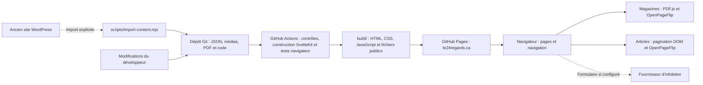

# 1. Vue d’ensemble

[Sommaire](README.md) · [Technologies →](02-technologies.md)

## Rôle du site

24 Regards est un journal francophone consacré au cinéma et à la cinéphilie, issu d’une initiative montréalaise. Le site propose les numéros du magazine en PDF, des articles indépendants et les profils des membres de la rédaction.

Le contenu est conservé dans le dépôt Git. La publication d’un texte passe par une modification des fichiers locaux, une vérification, puis une nouvelle construction du site. L’application actuelle ne comprend pas d’interface d’administration ni de base de données.

## Pages et fonctionnalités

| Adresse                               | Fonctionnement                                                                                                                                                                                                     | Fichiers principaux                                                                                                                                  |
| ------------------------------------- | ------------------------------------------------------------------------------------------------------------------------------------------------------------------------------------------------------------------ | ---------------------------------------------------------------------------------------------------------------------------------------------------- |
| `/`                                   | Présentation, catalogue de magazines, téléchargement et feuilletage. Le numéro le plus élevé est sélectionné par défaut. `?numero=9`, par exemple, sélectionne un autre numéro après initialisation du navigateur. | [+page.ts](../src/routes/+page.ts), [+page.svelte](../src/routes/+page.svelte), [MagazineReader.svelte](../src/lib/components/MagazineReader.svelte) |
| `/articles/`                          | Liste des textes et carnet de l’article le plus récent selon sa date.                                                                                                                                              | [articles/+page.ts](../src/routes/articles/+page.ts), [ArticleView.svelte](../src/lib/components/ArticleView.svelte)                                 |
| `/articles/[slug]/`                   | Même interface, avec un article désigné par une adresse partageable.                                                                                                                                               | [articles/[slug]/+page.ts](../src/routes/articles/%5Bslug%5D/+page.ts)                                                                               |
| `/redaction/` et `/redaction/[slug]/` | Sélection d’un rédacteur, coups de cœur et liens vers ses textes. Mathieu Giroux est sélectionné par défaut.                                                                                                       | [redaction/+page.ts](../src/routes/redaction/+page.ts), [AuthorView.svelte](../src/lib/components/AuthorView.svelte)                                 |
| `/participer/`                        | Section provisoire indiquant où rédiger les détails et attentes d’une participation.                                                                                                                               | [participer/+page.svelte](../src/routes/participer/+page.svelte)                                                                                     |
| `/citations/`                         | Sources, crédits des contenus et licences des bibliothèques.                                                                                                                                                       | [citations/+page.svelte](../src/routes/citations/+page.svelte), [credits.json](../src/lib/content/credits.json)                                      |

L’en-tête, les liens sociaux et le pied de page sont communs aux pages. La navigation passe en menu hamburger sous 768 px. Les listes d’articles et de rédacteurs deviennent des menus déroulants selon leurs propres seuils de largeur.

Le thème initial utilise la préférence du navigateur lorsqu’aucun choix n’est mémorisé. Le bouton permet ensuite de le changer et conserve ce choix localement. Il n’y a pas de suivi automatique des changements du système pendant la navigation.

Le bouton au pigeon ouvre une boîte de dialogue d’infolettre. Tant qu’aucun fournisseur n’est configuré, elle affiche « Inscriptions bientôt disponibles ». Une fois configuré, le formulaire envoie les données directement au fournisseur.

## Vue globale du système

Les pull requests exécutent les contrôles et la construction sans publier. Les envois sur `main` déclenchent également la publication, après réussite des vérifications. Le workflow permet aussi un lancement manuel. Voir [pages.yml](../.github/workflows/pages.yml).

## Ce que signifie « site statique »

Pendant `npm run build`, SvelteKit génère les pages HTML et `@sveltejs/adapter-static` écrit le site dans `build/`. Les routes dynamiques énumèrent leurs articles et rédacteurs pour produire un fichier pour chaque adresse connue. Le site utilise des adresses terminées par `/`.

GitHub Pages distribue ces fichiers. Il n’exécute pas de serveur Node.js pour chaque visite. Les fonctions `load` des routes préparent les données à la construction et peuvent aussi participer à la navigation SvelteKit dans le navigateur; elles ne constituent pas une API éditoriale distante.

Le JavaScript du navigateur initialise ensuite les lecteurs, le thème, le menu et l’infolettre. Les articles disposent déjà d’une version HTML en lecture continue avant l’initialisation du carnet. Les liens vers les PDF restent présents dans le HTML initial.

Pour rendre un changement de contenu visible en production, il faut **reconstruire puis publier**. Modifier un JSON local ne modifie pas à lui seul le site déjà hébergé.

Configuration correspondante : [+layout.ts](../src/routes/+layout.ts), [vite.config.ts](../vite.config.ts) et [workflow Pages](../.github/workflows/pages.yml).
