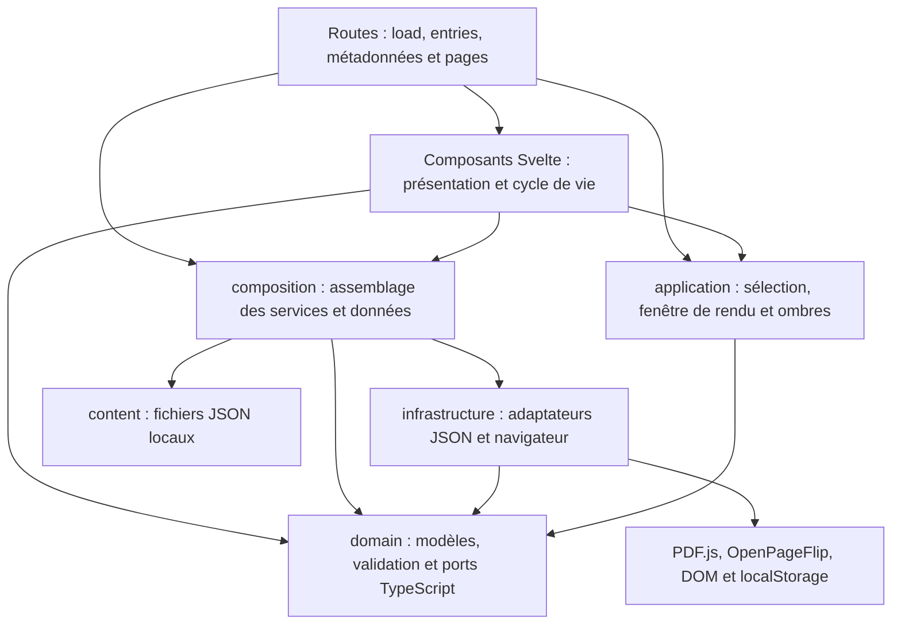

# 3. Architecture du code

[Sommaire](README.md) · [← Technologies](02-technologies.md) · [Parcours →](04-parcours.md)

## Responsabilités et dépendances

Le domaine définit les contenus et les contrats. L’application porte les règles de sélection et de lecture. Les adaptateurs réalisent les opérations techniques. La composition les assemble, puis les routes et composants présentent le résultat.

Dans ce diagramme, une flèche signifie « importe ou utilise ». Il représente les principales dépendances internes, pas l’ordre d’exécution d’une requête.

| Ensemble                                      | Contenu et rôle                                                                                                                                                                                                                                                     | Exemple d’intervention                                                           |
| --------------------------------------------- | ------------------------------------------------------------------------------------------------------------------------------------------------------------------------------------------------------------------------------------------------------------------- | -------------------------------------------------------------------------------- |
| [`domain`](../src/lib/domain)                 | `models.ts` décrit Magazine, Article, Redacteur, SiteConfig, Credit et ReaderError. `ports.ts` définit les interfaces. `validation.ts` vérifie les règles de cohérence des données. Le domaine reste indépendant de Svelte, du DOM et des bibliothèques de lecture. | Ajouter une propriété éditoriale ou une règle de validité.                       |
| [`application`](../src/lib/application)       | `catalog.ts` trie et sélectionne les contenus, réunit les références des rédacteurs. `raster-window.ts` limite les rendus et le cache PDF. `book-shadow.ts` calcule l’emprise de l’ombre selon la navigation et les gestes.                                         | Changer la sélection par défaut ou la stratégie de préchargement.                |
| [`infrastructure`](../src/lib/infrastructure) | Implémente les catalogues JSON, le rendu PDF.js, les commandes OpenPageFlip, la pagination DOM, le dimensionnement du magazine et la mémorisation du thème.                                                                                                         | Remplacer un moteur de rendu ou corriger une mesure navigateur.                  |
| [`composition`](../src/lib/composition)       | Charge et valide les JSON, crée les catalogues et expose les fabriques des services. Centralise aussi la base des chemins et les adresses canoniques.                                                                                                               | Brancher un nouvel adaptateur sans importer sa bibliothèque dans les composants. |
| [`components`](../src/lib/components)         | Reçoit les données, gère l’état de présentation, le montage, les événements et le nettoyage. Les lecteurs orchestrent leurs services via la composition.                                                                                                            | Changer un contrôle, une mise en page ou la présentation d’un état d’erreur.     |
| [`routes`](../src/routes)                     | Les `+page.ts` préparent les données, les fonctions `entries()` énumèrent les pages dynamiques. Les `+page.svelte` affichent les pages et métadonnées. `+layout.svelte` porte les éléments communs.                                                                 | Ajouter une adresse ou changer son comportement de sélection.                    |
| [`content`](../src/lib/content)               | Contient les collections JSON et la configuration publique.                                                                                                                                                                                                         | Publier un texte ou modifier un profil sans changer la logique du lecteur.       |

## Contrats entre les ensembles

Les interfaces de [ports.ts](../src/lib/domain/ports.ts) permettent aux fonctions de dépendre d’une capacité plutôt que d’une bibliothèque précise.

| Contrat                                              | Comportement attendu                                                                                                          | Implémentation actuelle                                                         |
| ---------------------------------------------------- | ----------------------------------------------------------------------------------------------------------------------------- | ------------------------------------------------------------------------------- |
| `MagazineCatalog`, `ArticleCatalog`, `AuthorCatalog` | Fournir une collection et chercher un élément par identifiant ou slug. `get` renvoie `undefined` si l’élément est absent.     | [json-catalog.ts](../src/lib/infrastructure/catalog/json-catalog.ts).           |
| `PdfRasterizer`                                      | Ouvrir un PDF, obtenir les dimensions d’une page, produire une image et libérer les ressources.                               | [pdf-rasterizer.ts](../src/lib/infrastructure/browser/pdf-rasterizer.ts).       |
| `ArticlePaginator`                                   | Recevoir du HTML et des dimensions; renvoyer des fragments avec leur position dans le texte. Accepter un signal d’annulation. | [article-paginator.ts](../src/lib/infrastructure/browser/article-paginator.ts). |
| `PageNavigator`                                      | Consulter l’état, avancer, reculer, aller à un index et observer les changements.                                             | [openpageflip.ts](../src/lib/infrastructure/browser/openpageflip.ts).           |
| `FlipProgressSource`                                 | Observer le mouvement d’un feuilletage, indépendamment des commandes de navigation.                                           | Même adaptateur OpenPageFlip, abonnement distinct pour les ombres.              |
| `ThemePreferenceStore`                               | Lire et écrire un choix clair/sombre, avec repli lorsque le stockage est bloqué.                                              | [theme-store.ts](../src/lib/infrastructure/browser/theme-store.ts).             |

Les indices des services commencent à **zéro**; les commandes affichent une numérotation à partir de **un**. `RasterPage.dispose()` libère une URL d’image temporaire. Une destruction ne doit pas rendre possible l’application ultérieure d’un ancien résultat asynchrone.

Pour les catalogues, les tests vérifient la même sélection avec un adaptateur JSON et un catalogue mémoire. Pour les lecteurs, les erreurs techniques sont converties en `ReaderError` lorsque l’adaptateur le prévoit. Ces comportements doivent être préservés lorsqu’un adaptateur est remplacé.

## Application des principes SOLID

- **Responsabilité unique** : sélection, rasterisation, pagination, dimensionnement, ombres et présentation sont séparés.
- **Ouvert à l’extension** : un numéro s’ajoute par ses données; un moteur technique peut être remplacé derrière un contrat.
- **Substitution** : un adaptateur de remplacement respecte les mêmes valeurs de retour, erreurs et règles de nettoyage.
- **Interfaces ciblées** : les trois catalogues sont distincts; navigation et progression du feuilletage sont séparées.
- **Inversion des dépendances** : les fonctions d’application importent les ports du domaine. La composition fournit les réalisations techniques.

Cette organisation repose sur des fonctions et une composition explicite. Elle n’exige pas une classe ou une interface supplémentaire pour chaque fonction d’affichage.

## Règles à respecter dans une modification

1. Conserver les règles éditoriales dans le domaine ou l’application, sans `window`, `document`, stockage ou dépendance Svelte.
2. Accéder aux bibliothèques de lecture dans `infrastructure`, puis les exposer par `composition`.
3. Faire passer les données éditoriales par les catalogues; éviter les imports directs de JSON dans les composants.
4. Réserver les routes aux adresses, données nécessaires à la page et métadonnées. Mutualiser une vue commune dans un composant.
5. Libérer les observateurs, abonnements et ressources du navigateur au remplacement ou au démontage d’un lecteur.

[check-architecture.mjs](../scripts/check-architecture.mjs), appelé par `npm run check`, détecte certains imports interdits dans `domain` et `application`, des accès directs au navigateur dans ces couches, ainsi que des imports techniques ou éditoriaux directs dans les composants. Il procède par recherche de motifs; il ne prouve pas à lui seul toutes les règles SOLID. La revue du code reste nécessaire.

Exemple : pour modifier le classement des articles, intervenir dans [articleSelection](../src/lib/application/catalog.ts), ajuster [catalog.test.ts](../tests/unit/catalog.test.ts), puis vérifier les vues Articles et Rédaction. Un changement de couleur se fait dans [global.css](../src/lib/styles/global.css) ou le composant concerné et demande une vérification visuelle.
